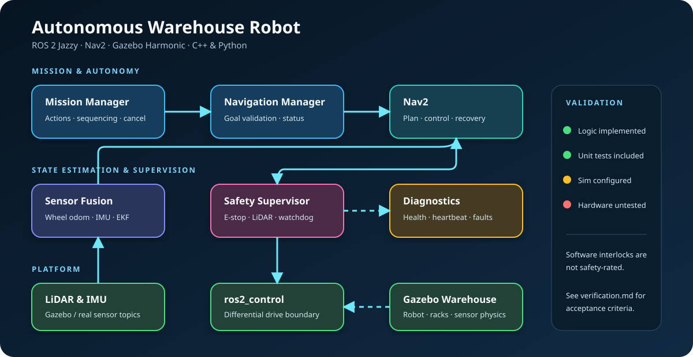
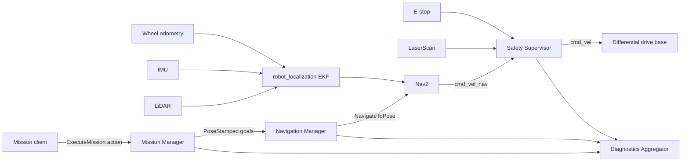

# ROS 2 Autonomous Warehouse Robot

[](https://docs.ros.org/en/jazzy/)
[](https://github.com/sri1650/ros2-autonomous-warehouse-robot/actions/workflows/ci.yml)
[](LICENSE)

A production-style autonomous mobile robot (AMR) software stack for warehouse missions, built with ROS 2, modern C++, Python, Nav2, Gazebo, and automated tests.

> **Validation status:** the architecture and application logic are implemented and covered by automated tests. The Gazebo/Nav2 stack is configured for simulation but still requires a ROS 2 Jazzy environment for end-to-end validation. No physical robot or safety-certified hardware has been tested; this repository must not be presented as hardware-validated or safety-rated.

## What this project demonstrates

- Layered ROS 2 architecture with clear package ownership and typed interfaces
- Sequential waypoint mission execution with cancellation and failure handling
- Nav2 waypoint dispatch through the `NavigateToPose` action
- LiDAR/IMU-ready robot model, `ros2_control`, and EKF sensor-fusion configuration
- Fail-safe velocity supervision for stale commands/sensors, emergency stops, and obstacle zones
- Runtime health aggregation and ROS diagnostics
- Gazebo Harmonic warehouse simulation and deterministic launch/configuration
- Unit, launch-smoke, lint, and CI build coverage
- Reproducible Docker and VS Code dev-container workflows

## System architecture





See [docs/architecture.md](docs/architecture.md) for node boundaries, topics, actions, lifecycle, and failure behaviour.

## Repository layout

| Package | Language | Responsibility |
|---|---|---|
| `warehouse_robot_interfaces` | ROS IDL | Mission action and safety-state message contracts |
| `warehouse_robot_mission` | Python | Mission parsing, queueing, execution, cancellation |
| `warehouse_robot_navigation` | C++ | Nav2 action adapter and navigation status |
| `warehouse_robot_safety` | C++ | Velocity watchdog, obstacle stop, e-stop interlock |
| `warehouse_robot_diagnostics` | Python | System health aggregation and heartbeat monitoring |
| `warehouse_robot_description` | URDF/Xacro | AMR model, sensors, and `ros2_control` interfaces |
| `warehouse_robot_bringup` | Launch/YAML | Gazebo, Nav2, EKF, SLAM/localisation, and application launch |

## Quick start

### Option A — dev container

Install Docker and VS Code with Dev Containers, clone this repository, then choose **Dev Containers: Reopen in Container**. Inside the container:

```bash
rosdep install --from-paths src --ignore-src -r -y
colcon build --symlink-install --cmake-args -DCMAKE_BUILD_TYPE=RelWithDebInfo
source install/setup.bash
ros2 launch warehouse_robot_bringup simulation.launch.py use_slam:=true
```

### Option B — native Ubuntu 24.04

Install ROS 2 Jazzy Desktop, Gazebo Harmonic integration, Nav2, SLAM Toolbox, and robot_localization. Then run the same `rosdep`, `colcon`, and launch commands above.

In another terminal, submit the example three-stop mission:

```bash
source install/setup.bash
ros2 action send_goal /execute_mission \
  warehouse_robot_interfaces/action/ExecuteMission \
  "{mission_id: demo-001, waypoints: [{header: {frame_id: map}, pose: {position: {x: 1.5, y: 0.0}, orientation: {w: 1.0}}}, {header: {frame_id: map}, pose: {position: {x: 1.5, y: 2.0}, orientation: {z: 0.707, w: 0.707}}}]}"
```

Run tests:

```bash
colcon test --event-handlers console_direct+
colcon test-result --verbose
```

## Operating modes

- `use_slam:=true`: build a map with SLAM Toolbox.
- `use_slam:=false map:=/absolute/path/map.yaml`: localise on a saved map using Nav2 AMCL.
- `headless:=true`: run Gazebo without the graphical client, useful in CI.
- `use_rviz:=false`: disable RViz for lower resource use.

## Safety boundary

The `warehouse_robot_safety` node demonstrates software safety patterns: default-safe startup, an e-stop interlock, stale command/sensor timeouts, LiDAR protective zones, speed limiting, and diagnostic reporting. It is **not** a certified safety function. Real deployments require an independent safety-rated circuit, verified stopping-distance calculations, risk assessment, and validation against applicable standards.

## Engineering evidence

- [Architecture and interfaces](docs/architecture.md)
- [Verification strategy and current evidence](docs/verification.md)
- [Hardware integration plan](docs/hardware-integration.md)
- [Engineering decisions](docs/decisions/)
- [Demo walkthrough](docs/demo.md)

## Roadmap

- [ ] Run and capture full Gazebo/Nav2 acceptance test on Ubuntu 24.04 + ROS 2 Jazzy
- [ ] Add automated docking server and battery model
- [ ] Add fleet task allocation and traffic management
- [ ] Add CANopen/EtherCAT hardware interface for a physical base
- [ ] Validate sensor timing, covariance, stopping distance, and recovery behaviour on hardware
- [ ] Add rosbag-based regression datasets and performance baselines

## License

MIT. See [LICENSE](LICENSE).
