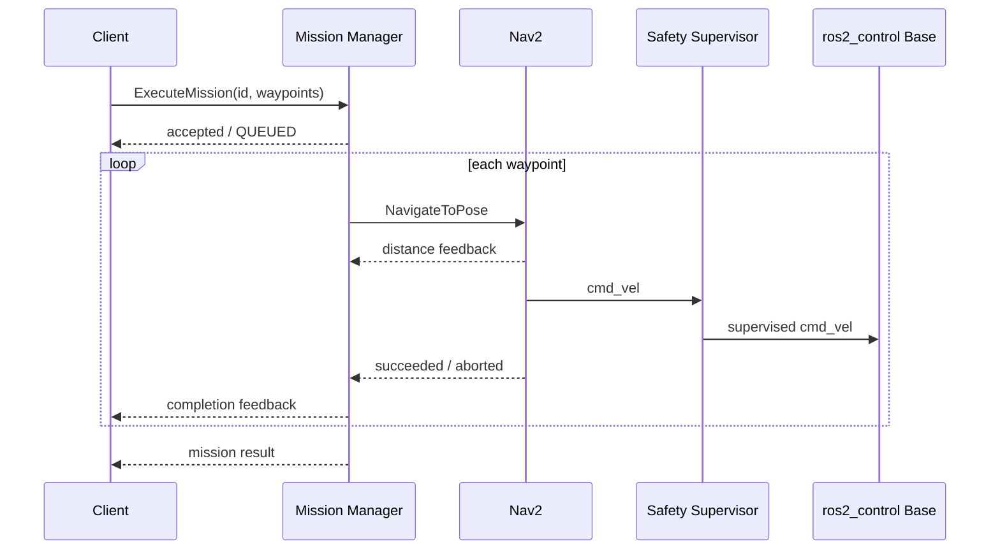

# Software architecture

## Design goals

The stack separates mission intent, navigation execution, state estimation, hardware access, and safety supervision so that each can be tested and replaced independently. ROS topics carry continuous state, actions carry long-running cancellable work, and parameters carry deployment-specific tuning.

## Runtime boundaries

| Node | Inputs | Outputs | Failure behaviour |
|---|---|---|---|
| `mission_manager` | `ExecuteMission` action | Nav2 goals, mission feedback/status | Rejects malformed missions; aborts when Nav2 rejects/fails; propagates cancellation |
| `navigation_manager` | `navigation/goal` | Nav2 goals, `navigation/status` | Rejects non-map goals; reports unavailable/rejected/aborted states |
| `ekf_filter_node` | Wheel odometry, IMU | `/odometry/filtered`, `odom→base_footprint` | robot_localization timeout/covariance diagnostics |
| Nav2 servers | Map, scan, filtered odometry, TF | `/cmd_vel`, action result/feedback | Behaviour-tree recovery, then action abort |
| `safety_supervisor` | `/cmd_vel`, `/scan`, e-stop | Controller velocity, `safety/state` | Zero velocity on startup, stale command, obstacle, or e-stop |
| `diagnostics_aggregator` | Application status and safety state | `/diagnostics` | Marks missing heartbeats as ERROR |

## Mission sequence



## Coordinate frames

```text
map ── localisation/SLAM ──> odom ── wheel odometry/EKF ──> base_footprint
                                                               └──> base_link
                                                                    ├──> lidar_link
                                                                    └──> imu_link
```

`map` absorbs long-term drift; `odom` remains locally continuous. Mission waypoints must be in `map`. The safety node operates directly on body commands and ranges and therefore does not depend on global localisation.

## Safety design

The software supervisor is fail-safe by default:

1. Before the first valid command, command age is stale and output is zero.
2. An e-stop assertion immediately forces zero output.
3. A missing LiDAR heartbeat or a valid scan inside the stop zone forces zero output.
4. An obstacle in the warning zone proportionally reduces forward speed.
5. Commands are capped at the configured maximum.
6. A lost command stream becomes stale after 500 ms and output returns to zero.

This is an application-layer safeguard, not a safety-rated control function. Hardware must independently remove or inhibit drive torque.

## Extension points

- Implement `ros2_control::SystemInterface` for a CANopen/EtherCAT base.
- Add AprilTag or reflector localisation as another fused measurement.
- Replace the single-robot mission input with a fleet allocator.
- Add a docking action and battery-management state to the mission graph.
- Record rosbag scenarios and replay them in regression CI.
